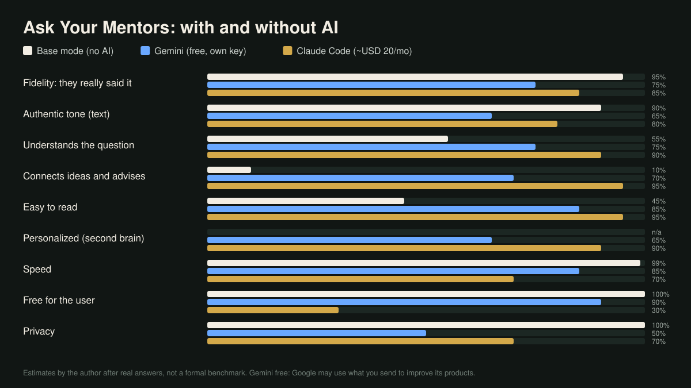
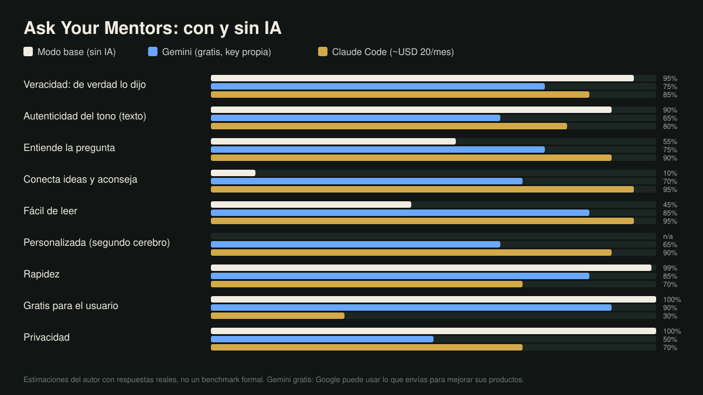

<p align="center"></p>

<h1 align="center">Ask Your Mentors</h1>

<p align="center"><b>Ask the people you learn from. Answers in their own words, cited to the exact minute.</b><br>
Open source · runs on your computer · AI optional · English and Spanish · <a href="#en-español">En español</a></p>

<p align="center"></p>

## What it does

- **Type a name, get a mentor.** The app finds their YouTube channel and podcast, you confirm, and it downloads the transcripts (text only, never video).
- **Ask anything.** One mentor, several at once, or let the AI pick who has something real to say. Every idea links to the minute it was said.
- **Works without AI.** Base mode answers in under a second with their exact words. Turn the AI on for written answers that connect ideas (Claude Code, or Gemini for free).
- **Yours.** Everything lives on your computer. Optional: connect your own notes (second brain) so the advice fits your life.

## Get it

**With your AI (no programming needed):** open Claude Code in your projects folder and paste the prompt in [INSTALL_WITH_AI.md](INSTALL_WITH_AI.md). It explains each step and asks before installing anything.

**By hand:**

```bash
git clone https://github.com/georgewashtol/ask-your-mentors
cd ask-your-mentors
python3 app.py --check    # what this computer is missing, with the command to install it
python3 app.py            # opens http://localhost:7720
```

Needs Python 3.9+ (no `pip install`) and `yt-dlp` for YouTube. The AI is optional. It comes with one sample mentor, the author, so you can try it right away; remove him in **My mentors** and he does not come back.

## Base mode, Gemini or Claude?



| | Base mode (no AI) | Gemini (free, your own key) | Claude Code (~USD 20/month) |
|---|---|---|---|
| Fidelity: they really said it | 95% | 75% | 85% |
| Understands the question | 55% | 75% | 90% |
| Connects ideas and advises | 10% | 70% | 95% |
| Personalized with your second brain | n/a | 65% | 90% |
| Speed | 99% (0.1 s) | 85% (a few seconds) | 70% (about 20 s) |
| Free for you | 100% | 90% (daily limits) | 30% (paid plan) |
| Privacy | 100% (nothing leaves) | 50% (see below) | 70% (your account's settings) |

The author's estimates after real answers, not a formal benchmark.

**Gemini for free:** get a key at [aistudio.google.com/apikey](https://aistudio.google.com/apikey) with any Google account (no card), then in the app turn the **AI** switch on, choose **Gemini · free** and paste it. On the free plan Google may use what you send to improve its products and people may review it: do not use it with sensitive information.

<details>
<summary><b>Second brain</b> (optional, off by default)</summary>

Turn on **Second brain** in the sidebar: choose the folder of your notes (Obsidian, Markdown, any text) in your computer's own folder picker, or let the app **create one from scratch** for you: 8 areas of your life and the prompts so your AI interviews you and fills it. With the AI on, only the few notes that matter to each question are used, read-only (Claude searches them itself; with Gemini or Ollama the app sends the 4 most relevant). The mentors still speak only from their transcripts, and facts about you are never put in their mouth. Folders that are too broad (your home folder, the disk) are refused.
</details>

<details>
<summary><b>Where your data goes</b></summary>

| What | Stays on your computer | Goes out |
|---|---|---|
| App, settings, chats, transcripts, search index | always | never: no telemetry, the server only listens on 127.0.0.1 |
| Your second brain | always (read in place, never copied) | with the AI on: only the notes that matter for that question (Claude picks them; with Gemini or Ollama the app sends the 4 most relevant) |
| Your question and the transcript excerpts | in base mode or with a local AI (Ollama) | with a cloud AI (Claude, Gemini): sent to that provider to answer |
| Downloads | | YouTube and podcast hosts see which channels you download, not your questions |
</details>

<details>
<summary><b>Requirements and hardware</b></summary>

| Piece | What for | Needed? |
|---|---|---|
| Python 3.9+ | runs the app | yes |
| yt-dlp | YouTube subtitles (text only) | yes, for YouTube |
| Claude Code (Pro or Max plan) or a free Gemini key | written answers, profiles, finding mentors online | optional |
| ffmpeg + whisper-cli + a model | transcribes podcasts that publish no transcript | optional |
| pdftotext | reads PDFs on Linux and Windows (macOS has it built in) | optional |

Transcribing is the only heavy part, and only for podcasts that publish no transcript (YouTube subtitles are tiny text files). Measured on an Apple M1 Pro with the large model: an hour of audio in about 3 minutes, 1.8 GB of RAM and about 70 MB downloaded. On a computer without Apple Silicon the app uses the small model, several times faster on a regular CPU. Minimum 4 GB of RAM and 2 GB of disk (recommended 8 GB and 10 GB: transcripts take about 1 GB per 5,000 videos). Built and tested on macOS; Linux and Windows are supported by design but less tested.

macOS: `brew install python yt-dlp ffmpeg whisper-cpp`. Linux: `sudo apt install python3 ffmpeg pipx && pipx install yt-dlp`. Windows: `winget install Python.Python.3.12 yt-dlp.yt-dlp Gyan.FFmpeg`.
</details>

<details>
<summary><b>Make it yours</b> (your AI does the work)</summary>

The screen has the minimum on purpose. Everything else you ask your AI from this folder, in plain words; [AGENTS.md](AGENTS.md) is the manual it follows. For example: *"Change the accent color to green"*, *"Add this podcast to Cal Newport: https://..."*, *"End every answer with a question to reflect on"*, *"Use Ollama instead of Claude"*.

Your data lives apart from the code (`data/`, or any folder with `--data`), so `git pull` never touches it and one code can run several instances. Own login, rules or prompts go in `config.json` or in an extension file, not in the code.
</details>

<details>
<summary><b>Project structure</b></summary>

```
app.py         HTTP server (127.0.0.1 only) and /api routes
advisor.py     prompts per mode, base mode, RAG and the language rule
ai.py          AI providers: claude, gemini, codex, ollama, command, none
store.py       settings, SQLite, mentors, corpus protocol, migrations
ingest.py      background queue: yt-dlp, RSS, whisper, documents, profiles
identify.py    finds a person's official channels and podcast
fulltext.py    search index (SQLite FTS5): answers in milliseconds
search.py      corpus search (CLI the agent uses + chat functions)
brain.py       second brain: read-only access, folder picker, create from a template
templates/     the starter second brain (English and Spanish)
texts.py, clean.py, thumbnails.py, doctor.py, i18n.py
static/        interface: vanilla JS, no build, no CDN
tests.py       python3 tests.py
```
</details>

<details>
<summary><b>About YouTube</b></summary>

YouTube's terms do not allow automated downloading, subtitles included, without their permission. yt-dlp is legal open-source software, but using it is your responsibility: personal study only, never redistribute transcripts, and expect YouTube to slow you down if you download a lot. Podcasts with RSS feeds, PDFs and web pages do not have this problem.
</details>

## En español

**Pregúntale a las personas de las que aprendes y recibe respuestas con sus propias palabras, con la cita al minuto exacto.** Escribes un nombre, la app encuentra su canal y su podcast, confirmas y descarga las transcripciones. Funciona sin IA (modo base, al instante) y con IA opcional: Claude Code o Gemini gratis con tu propia clave. Todo vive en tu computador.

- **Instalarla con tu IA:** pega el prompt de [INSTALL_WITH_AI.md](INSTALL_WITH_AI.md) en Claude Code.
- **Ponerla en español:** selector **EN | ES** abajo a la izquierda. La interfaz y las respuestas de la IA quedan en español.
- **Gemini gratis:** saca tu clave en [aistudio.google.com/apikey](https://aistudio.google.com/apikey), enciende el switch de la **IA**, elige **Gemini · gratis** y pégala. En el plan gratis Google puede usar lo que envías para mejorar sus productos: no lo uses con información sensible.
- **Segundo cerebro (opcional):** la IA puede LEER tu carpeta de notas para personalizar las respuestas; nunca la modifica. Si no tienes uno, la app te lo crea desde cero con 8 áreas de tu vida y los prompts para que tu IA te entreviste y lo llene.



Si venías de la versión anterior (*Referentes*), tu carpeta de datos se migra sola y se queda en español.

## License

Code under the MIT license: use it, change it, sell it, just keep the copyright notice. The name "Ask Your Mentors", the logo and Washtol are not part of that license. Third-party pieces: [THIRD_PARTY_NOTICES.md](THIRD_PARTY_NOTICES.md).

Answers are a simulation based on each mentor's public content: the mentors do not endorse this app or what it writes in their name.

Made by Jorge Toledo ([@georgewashtol](https://github.com/georgewashtol)) · Created by [Washtol](https://washtol.com)
